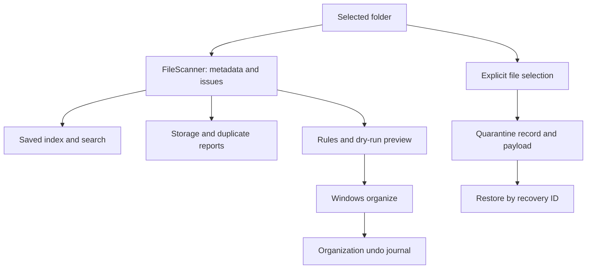
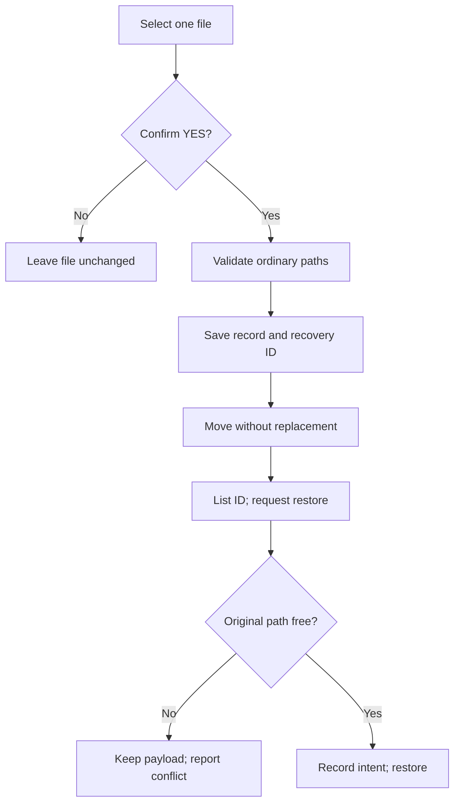

<div align="center">

# FolderFlow Guardian

**Understand a folder. Preview a reusable filing rule. Move deliberately—and recover.**

Software Project Lab I · Institute of Information Technology, University of Dhaka<br>
Md. Tasnimul Hasan Tamim · BSSE1721 · C++17 · Windows / PowerShell / MSYS2 G++

  

[Start](#quick-start) · [Features](#implemented-features) · [Architecture](#how-it-works) · [Safety](#file-safety-and-recovery) · [Progress](#development-status)

</div>

> **Checkpoint:** This page describes `phase4/4.5a-safe-quarantine` at `d6e6354`. The default `main` branch is an older Phase 3 checkpoint. Select the feature branch on GitHub to inspect the code described here; this README redesign lives on a separate documentation branch.

## The problem

A semester's downloads can accumulate lecture PDFs, source code, images and repeated copies across nested directories. FolderFlow Guardian connects discovery, saved metadata, storage reports, content duplicate reports and configurable **extension-based** filing in a single console workflow. Preview destinations before organizing, undo supported moves, or quarantine a specifically selected file for later recovery.

Windows File Explorer already performs individual file operations. This project demonstrates a repeatable policy and inspectable algorithms. It does **not** replace Explorer, Recycle Bin or backup software. Configuring rules takes effort; one policy can then be reused. It cannot understand a document's course or subject from its content.

## Implemented features

| Area | What works | Command / menu |
| --- | --- | --- |
| Scan | Recursive ordinary-folder traversal; relative path, type, extension, size and modification metadata | `--scan` / 1 |
| Index | Persist metadata, search by path/extension/partial filename, compare saved index with fresh scan | `--save-index`, `--load-index`, `--find-name`, `--check-index` / 3 for name search |
| Storage | Extension totals, percentages and largest files/subtrees with bounded Top-K ranking | `--analyze-storage` / 2 |
| Duplicates | Size groups → buffered FNV-1a hash → full byte comparison; potential reclaimable logical bytes | `--find-duplicates` / 7 |
| Rules | Parse extension mappings, evaluate conflicts, preview destinations | `--check-rules`, `--evaluate-rules`, `--dry-run` / 4 |
| Organize | Windows moves without replacing occupied destinations; separate persistent undo journal | `--organize`, `--undo` / 5–6 |
| Quarantine | Explicitly selected regular file, confirmation, persistent ID and record, listing and no-overwrite restore | `--quarantine`, `--list-quarantine`, `--restore-quarantine` / 8–10 |

Version retention and snapshots are **not implemented**. The menu exposes working options; organization and undo are Windows-only.

## Quick start

In Windows PowerShell, with a C++17-capable `g++` on PATH, run these commands from the repository root. Git and VS Code are useful for development.

```powershell
git clone https://github.com/thtamim01/SPL_1_BSSE1721.git
Set-Location .\SPL_1_BSSE1721
git switch phase4/4.5a-safe-quarantine
powershell -NoProfile -ExecutionPolicy Bypass -File .\scripts\build.ps1
powershell -NoProfile -ExecutionPolicy Bypass -File .\scripts\test.ps1
.\build\folderflow.exe
```

The execution-policy option affects only the launched process. **Build before running:** an old executable may lack newer commands. No arguments open the menu; `--scan` preserves the original scanner prompt.

| Number | Menu option | Number | Menu option |
| --- | --- | --- | --- |
| 1 | Scan a folder | 2 | Analyze storage |
| 3 | Search a saved index | 4 | Preview organization |
| 5 | Organize files | 6 | Undo organization |
| 7 | Find duplicate files | 8 | Quarantine a file |
| 9 | List quarantined files | 10 | Restore a quarantined file |
| 0 | Exit | | |

Enter a number and an existing folder path. Option 8 asks for a **relative file path** within that folder; option 10 asks for a recovery ID shown by option 9. Menu options 5 and 6 ask for confirmation; quarantine and restore require an exact `YES` in both menu and CLI. Direct `--organize` and `--undo` act when invoked, so use the preview first.

## How it works



[`src/main.cpp`](src/main.cpp) is an eight-line entry point delegating to `runCli()` in [`cli_dispatcher.cpp`](src/cli_dispatcher.cpp). [`menu.cpp`](src/menu.cpp) gathers numbered inputs and calls that same dispatcher. The scanner supplies metadata for reports; quarantine independently validates its chosen file. The dispatcher still contains substantial organization logic; modularization is ongoing.

| Module | Responsibility |
| --- | --- |
| [`file_metadata.hpp`](src/file_metadata.hpp), [`scanner.cpp`](src/scanner.cpp) | Scan entries, issues and iterative traversal |
| [`file_index.cpp`](src/file_index.cpp), [`application.cpp`](src/application.cpp) | Metadata index and original scanner workflow |
| [`storage_analyzer.cpp`](src/storage_analyzer.cpp), [`duplicate_detector.cpp`](src/duplicate_detector.cpp) | Read-only analytics and content comparisons |
| [`rule_config.cpp`](src/rule_config.cpp), [`cli_dispatcher.cpp`](src/cli_dispatcher.cpp) | Rule validation, CLI routing, moves and undo |
| [`menu.cpp`](src/menu.cpp), [`quarantine.cpp`](src/quarantine.cpp) | Menu navigation and separate recovery records |

Corresponding declarations are in `src/*.hpp`; [`scripts/build.ps1`](scripts/build.ps1) and [`scripts/test.ps1`](scripts/test.ps1) list the compilation units.

### Algorithms and data structures

| Purpose | Technique and code | Benefit and limit |
| --- | --- | --- |
| Nested traversal | Explicit `std::vector` stack in [`scanner.cpp`](src/scanner.cpp); sorted results | Avoids recursive call-stack growth and gives repeatable output; excludes links/reparse points |
| Metadata lookup | `std::map` by normalized relative path; secondary extension-to-path grouping in [`file_index.cpp`](src/file_index.cpp) | Saved searches without rescanning; old indexes can be stale |
| Largest paths | Custom bounded min-heap `TopItems`, `consider()` and `siftDown()` in [`storage_analyzer.cpp`](src/storage_analyzer.cpp) | At most K contenders; selection O(N log K) for N candidates, excluding subtree aggregation |
| Content duplicates | Size buckets, buffered 64-bit FNV-1a and byte comparison in [`duplicate_detector.cpp`](src/duplicate_detector.cpp) | A hash narrows candidates; collisions alone never prove equality |
| Reusable filing | Extension parser in [`rule_config.cpp`](src/rule_config.cpp); conflict checks and preview in [`cli_dispatcher.cpp`](src/cli_dispatcher.cpp) | Examine destinations before moving |
| Recovery | Move journal in [`cli_dispatcher.cpp`](src/cli_dispatcher.cpp); unique ID and record in [`quarantine.cpp`](src/quarantine.cpp) | Two separate workflows; occupied destinations are refused |

## Disposable Windows walkthrough

Create a **temporary fixture** from the repository root; these commands never target your personal files. Generated paths and IDs vary.

```powershell
$demo = Join-Path $env:TEMP ('FolderFlow-readme-' + [guid]::NewGuid())
New-Item -ItemType Directory -Path $demo | Out-Null
New-Item -ItemType Directory -Path (Join-Path $demo 'nested') | Out-Null
[IO.File]::WriteAllText((Join-Path $demo 'report.pdf'), 'same contents')
[IO.File]::WriteAllText((Join-Path $demo 'nested\copy.pdf'), 'same contents')
[IO.File]::WriteAllText((Join-Path $demo 'photo.jpg'), 'sample photo')
$index = Join-Path $env:TEMP ('FolderFlow-index-' + [guid]::NewGuid() + '.txt')
```

| Action | Command | Effect |
| --- | --- | --- |
| Scan | `.\build\folderflow.exe --scan $demo` | Read-only; three files, one nested folder |
| Analyze | `.\build\folderflow.exe --analyze-storage $demo 3` | Read-only extension shares and top three paths |
| Save index | `.\build\folderflow.exe --save-index $demo $index` | Writes a saved index in TEMP |
| Find | `.\build\folderflow.exe --find-name $index 'report'` | Searches saved metadata without scanning |
| Compare | `.\build\folderflow.exe --check-index $demo $index` | Before changes, expect `Changed: 0, Missing: 0` |
| Duplicates | `.\build\folderflow.exe --find-duplicates $demo` | Read-only; PDF files form one confirmed group |
| Preview | `.\build\folderflow.exe --dry-run $demo .\config\extension-rules.txt` | Read-only PDF → Documents, JPG → Images proposals |

The [sample rules](config/extension-rules.txt) can be checked with `--check-rules`. The duplicate report estimates **logical** reclaimable bytes; it does not free disk space. Saved indexes describe a point in time.

On **Windows**, the next commands move only this disposable fixture. Preview first; the PDF filenames differ, so their destinations do not collide. Inspect paths before moving; `--undo` concerns organization, not quarantine.

```powershell
.\build\folderflow.exe --organize $demo .\config\extension-rules.txt
.\build\folderflow.exe --undo $demo
```

Illustrative output: `MOVED: report.pdf -> Documents/report.pdf`, followed by `RESTORED: Documents/report.pdf -> report.pdf`. Direct `--organize` starts immediately; the menu asks for confirmation. The journal records supported movements.

Quarantine one file after explicit `YES`, list its record, then restore **that ID**:

```powershell
$move = 'YES' | .\build\folderflow.exe --quarantine $demo 'photo.jpg'
$move
$id = [regex]::Match(($move -join ' '), 'ID: ([0-9a-f]{32})').Groups[1].Value
if (-not $id) { throw 'No recovery ID; stop and inspect output.' }
.\build\folderflow.exe --list-quarantine $demo
'YES' | .\build\folderflow.exe --restore-quarantine $demo $id
```

Expected pattern: `QUARANTINED photo.jpg ID: <id>`, a listing with `<id> QUARANTINED`, then `RESTORED photo.jpg ID: <id>`. Listing is read-only. The [recovery guide](learnings/phase4-4.5a-safe-quarantine.md#try-it-in-windows-powershell) includes a fuller disposable test.

## File safety and recovery



Scanning, analytics, duplicate detection and dry-run are read-only. Organization uses `.folderflow-undo`; quarantine uses a **separate** `.folderflow-quarantine/<id>/record.txt` and payload. Quarantined content remains on the same volume, so it does not automatically reclaim physical space. Restore refuses occupied paths and damaged or missing records. The scanner excludes `.git` and quarantine data; links and Windows reparse points are avoided.

Neither move/journal pair is a crash-proof transaction. Concurrent changes, interruption, permissions, network shares or unusual filesystems can require manual review. Incomplete records are reported, and quarantine has no cross-volume copy-and-delete fallback. See [design limits](learnings/phase4-4.5a-safe-quarantine.md#interrupted-operations-and-limits).

## Testing and verification

[`scripts/test.ps1`](scripts/test.ps1) compiles the application and runs scanner, index, storage, menu, dispatcher, duplicate and quarantine suites using disposable fixtures. Compilation, named automated PASS results and actual Windows demonstrations are different evidence. SKIP means a fixture was unavailable, not that the condition passed.

At the Phase 4.5A checkpoint, **91 passed, 0 failed, 0 skipped on Linux** with strict C++17 warnings. On Windows, the visible menu, dispatcher, duplicate and quarantine summaries had zero failures; quarantine reported **9 passed and 1 skipped** because its link fixture was unavailable. A disposable file was quarantined, listed and restored; a before/after SHA-256 comparison printed `PASS: restored content matches`. The feature branch was pushed. This verifies that demonstration, not all crash scenarios. The earlier Phase 4.4 Windows checkpoint reported 73 passed, zero failed and six scanner skips, plus an unavailable link fixture.

See [test instructions](tests/README.md). No CI badge, coverage percentage or benchmark is claimed.

### Earlier disposable Windows demonstration

A separately reported five-file fixture (empty BMP, 41-byte Python file, 30-byte C file and two identical 462-byte text files) produced **5 files, 1 subfolder, 995 logical bytes**. Storage analysis attributed 924 bytes (92.86%) to TXT, 41 (4.12%) to PY, 30 (3.02%) to C and zero to BMP. Duplicate detection found one confirmed text-file group with 462 potentially reclaimable logical bytes. The five proposed destinations were previewed, then five files were organized and independently checked at their destinations; undo returned them to their original paths and removed created empty folders. These are results of that fixture, not performance or universal correctness claims.

## Development status

| Milestone | State |
| --- | --- |
| Phase 1 — scanning and metadata | Implemented; historical [evidence](docs/evidence) |
| Phase 2 — persistent index and search | Implemented and tested |
| Phase 3 — rules, preview, Windows moves and undo | Implemented; older `main` checkpoint |
| Phase 4.1 — storage analysis | Implemented, demonstrated on Windows |
| Phase 4.2 — interactive menu | Implemented, demonstrated on Windows |
| Phase 4.3A — CLI dispatcher | Implemented, checked on Windows |
| Phase 4.4 — content duplicates | Implemented, independently checked on Windows |
| Phase 4.5A — quarantine and recovery | Implemented; disposable Windows round trip and hash comparison; further failure testing remains |

**Planned, not implemented:** easier rule editing and templates; friendlier recovery selection; file versions and content snapshots; folder snapshot manifests; chunk comparisons and possible reusable chunk storage; larger-data benchmarks; final integration and regression review. The program remains console-based, does not classify files by course, and is not a professional backup tool.

## Project navigation

[Architecture](docs/architecture.md) · [Development roadmap](docs/DEVELOPMENT_ROADMAP.md) · [Learning notes](learnings/README.md) · [Tests](tests/README.md) · [Disposable scanner fixture](demo/README.md) · [Source](src) · [Rules](config/extension-rules.txt)

The default GitHub landing page remains at the older `main` checkpoint until separately reviewed integration. This documentation branch does not merge development code into `main`.
